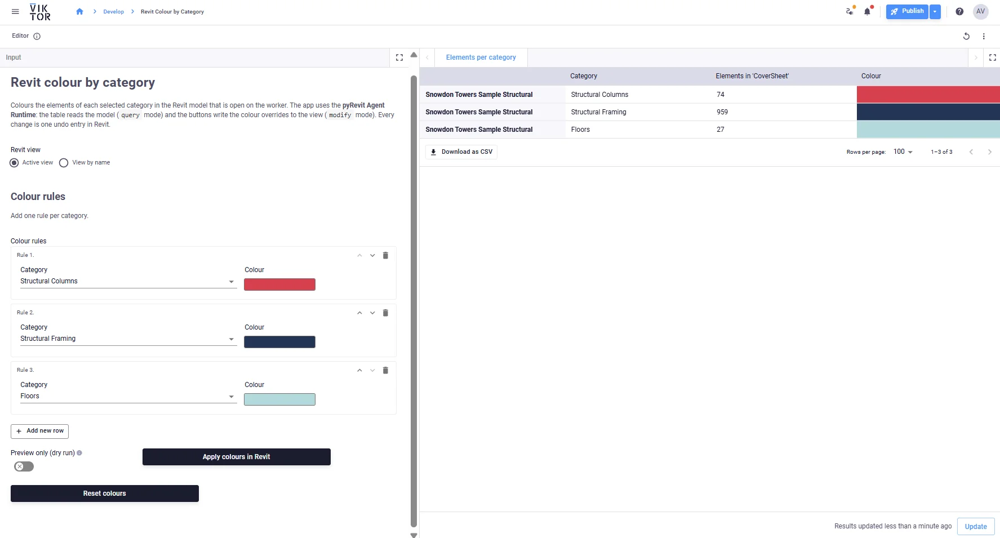
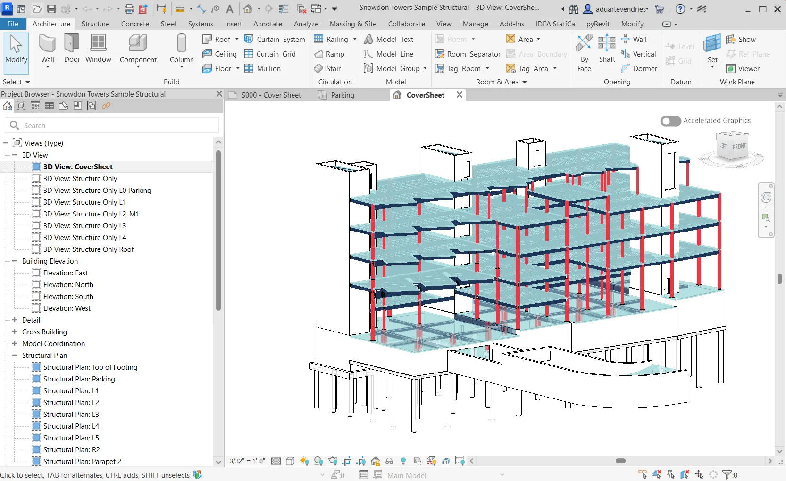
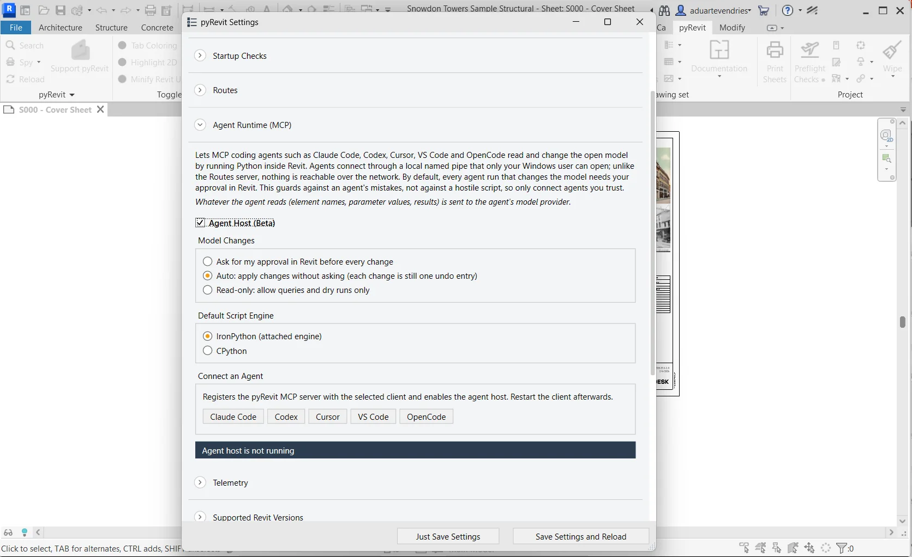
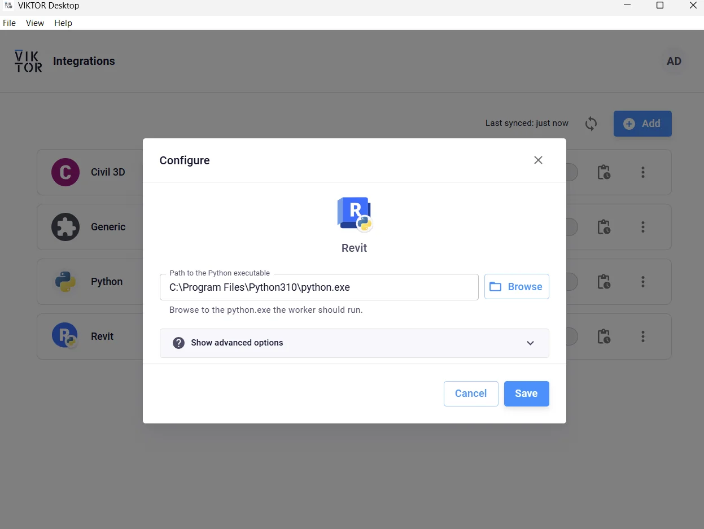

# pyrevit-viktor-integration

Colour Revit elements by category from a VIKTOR app. Pick categories and colours in VIKTOR, and the app applies
them to the model that is open in Revit, live, through the [pyRevit Agent Runtime](https://docs.pyrevitlabs.io/agent-runtime/).

<p>
  
  
</p>

## How it works

1. In the VIKTOR app you add one **colour rule** per category (dynamic array with a category dropdown and a colour field).
2. VIKTOR sends a reviewed Revit script plus a small `job.json` to the **Revit worker** with `vkt.revit.RevitAnalysis`.
3. The worker script (`revit_scripts/run_agent.py`) runs `pyrevit agent run`, which executes the script inside the
   Revit session that is already open, and writes the JSON response to `output.json`.
4. VIKTOR reads `output.json` and shows the result.

| Action in the app          | pyRevit mode      | What happens in Revit                                              |
|----------------------------|-------------------|--------------------------------------------------------------------|
| *Elements per category*    | `--mode=query`    | Counts the elements per category in the view; nothing is changed   |
| *Apply colours in Revit*   | `--mode=modify`   | Sets a solid colour override per category in the view (one undo entry) |
| *Preview only* + *Apply*   | `--mode=dry_run`  | Runs the change and rolls it back; reports what would change       |
| *Reset colours*            | `--mode=modify`   | Clears the colour overrides of the selected categories             |

The target view is either the **active view** in Revit or a **view by name** (e.g. `Structure Only`).

## Setup

### 1. Install and set up pyRevit

1. Install [pyRevit 7.0 or newer](https://github.com/pyrevitlabs/pyRevit/releases) (`pyRevit_<version>_signed.exe`).
2. Start Revit, open a model and go to **pyRevit → Settings → Agent Runtime (MCP)**.
3. Tick **Agent Host (Beta)** and choose how model changes are handled:
   **Ask** (Keep/Discard prompt in Revit for every change, default) or **Auto** (applied directly).
   Keep **IronPython** as the default script engine. The *Connect an Agent* buttons are not needed.
4. Click **Save Settings and Reload**.



Check that Revit is listening:

```
pyrevit agent status
```

### 2. Set up the Revit worker in VIKTOR Desktop

1. Install and log in to [VIKTOR Desktop](https://docs.viktor.ai/docs/create-apps/software-integrations/viktor-desktop/)
   with the same Windows user that runs Revit (the agent host only accepts connections from that user).
2. Click **Add**, select **Revit** and set the path to the Python executable, for example
   `C:\Program Files\Python310\python.exe`. The worker script only uses the Python standard library.
3. Click **Save** and make sure the Revit worker is running.



### 3. Run the app

```
viktor-cli clean-start
```

`viktor.config.toml` already contains `worker_integrations = ["revit"]`.

## Structure

```
app.py                              # VIKTOR app: colour rules, TableView, action buttons
viktor.config.toml                  # editor app, worker_integrations = ["revit"]
requirements.txt
revit_scripts/
    run_agent.py                    # worker script: calls `pyrevit agent run` and writes output.json
    model_info.py                   # Revit script (query): elements per category in the target view
    colour_by_category.py           # Revit script (modify): colour overrides per category
docs/images/                        # screenshots used in this README
```

## Test a Revit script without VIKTOR

```
pyrevit agent run revit_scripts\model_info.py --mode=query --inputs="{\"target\": {\"mode\": \"active\"}, \"categories\": [\"OST_Walls\"]}"
pyrevit agent runs
```

## Notes

- Revit must be open with a model. `modify` runs are refused when no document is active.
- The Revit scripts ship with the app; user input only reaches Revit as values in `inputs`. Do not send code typed by
  app users to the worker: `query` mode protects the Revit model, not the worker machine.
- pyRevit stores each run's script and result under `%APPDATA%\pyRevit\agent` for 14 days.
- The Agent Runtime is marked experimental by pyRevit. Tested with Revit 2027 and pyRevit 7.0.0.
